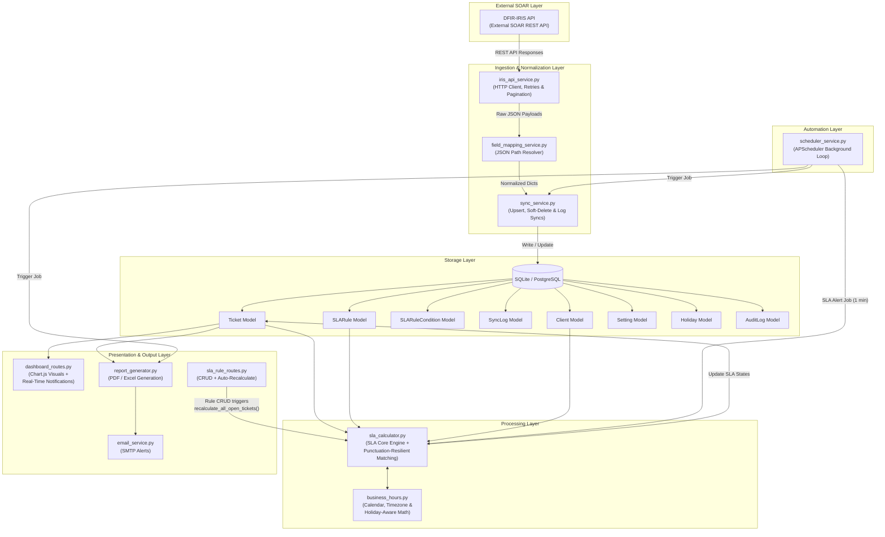
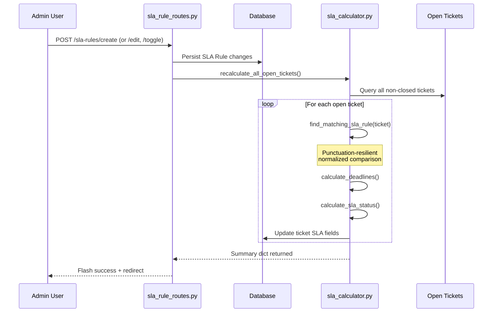
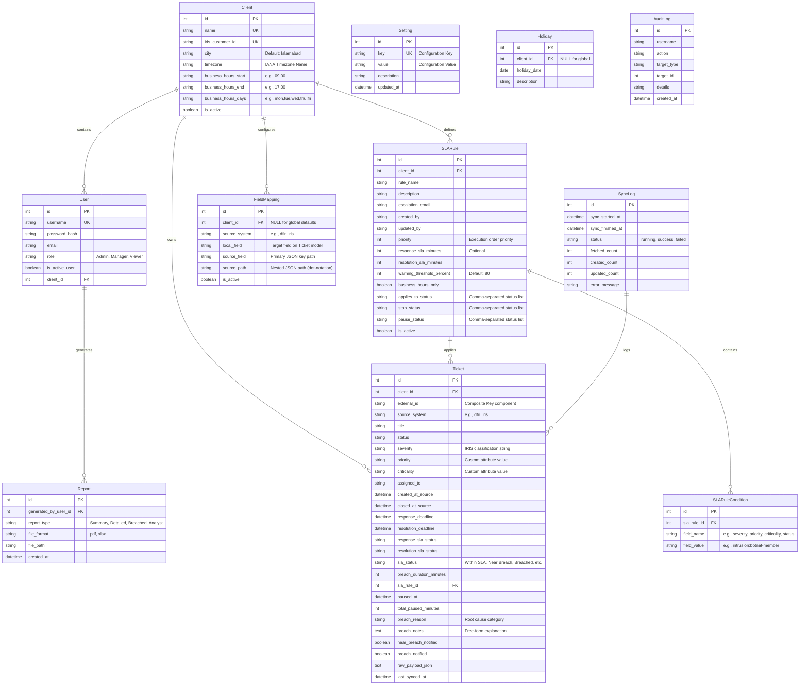
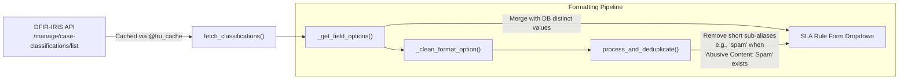

# Software Design Document: Automated SLA Tracking & Report Generation System

**Version:** 2.0  
**Last Updated:** July 30, 2026  
**Authors:** Abdullah & Usman  
**Platform Integration:** DFIR-IRIS (Incident Response Platform / SOAR)

---

## 1. Executive Summary

The **Automated SLA Tracking & Report Generation System** is a multi-tenant middleware designed to integrate with the **DFIR-IRIS** Incident Response Platform (SOAR). It automates the extraction, normalization, and tracking of incident response and resolution SLAs (Service Level Agreements) across multiple client environments. The system dynamically computes SLA deadlines based on custom client business hours, manages incident pause/resume cycles, generates comprehensive PDF and Excel performance reports, and sends consolidated breach alerts to security managers.

### 1.1 Key Capabilities
- **Real-time SLA Monitoring** with 1-minute background recalculation cycles
- **Punctuation-Resilient Rule Matching** that handles format discrepancies between IRIS classification strings and human-readable rule definitions (e.g. `intrusion:botnet-member` ↔ `Intrusion: Botnet Member`)
- **Automatic SLA Recalculation** triggered immediately when rules are created, edited, or toggled — no manual intervention required
- **Multi-Condition SLA Rules** supporting complex matching logic across severity, priority, criticality, and status fields
- **Customer Auto-Sync** from DFIR-IRIS that automatically provisions and updates local Client records
- **IRIS Classification Integration** that populates SLA rule dropdowns with live classification taxonomies from the connected IRIS instance
- **In-App Notification System** providing real-time near-breach and breach alerts in the navigation bar

---

## 2. System Architecture

The application is built on a modular, service-oriented architecture using the Flask **Application Factory Pattern** with Blueprints to separate routes by functional areas.

### 2.1 Architectural Flow Diagram

The data pipeline flows downward from the external SOAR platform to database ingestion, SLA evaluation, and output generation.



### 2.2 Reactive SLA Recalculation Flow (New)

When an administrator creates, edits, or toggles an SLA rule, the system immediately recalculates all open tickets without waiting for the next scheduled sync cycle:



---

## 3. Data Models & Schema Design

The system implements **11 core models** utilizing SQLAlchemy ORM. Multi-tenancy is enforced at the database layer via client scoping on core resources.



---

## 4. Service Components

### 4.1 Ingestion Wrapper (`services/iris_api_service.py`)

Fetches incident, alert, customer, and classification data from DFIR-IRIS.

*   **Pagination (Gap #6):** Implements an envelope-aware loop that extracts parameters (`total`, `last_page`, `current_page`) from IRIS response metrics to fetch all available records.
*   **Robust Network Client (Gap #7):** Incorporates connection timeouts and transient error retries (status codes `429`, `500`, `502`, `503`, `504`) using exponential backoff:
    $$\text{Delay} = \text{backoff\_factor} \times (\text{backoff\_multiplier})^{\text{attempt}}$$
*   **Classification Fetching:** Retrieves IRIS case classifications (`/manage/case-classifications/list`) and caches them via `@lru_cache`. These classifications populate the SLA rule form's field value dropdowns.
*   **Customer Sync Endpoint:** Fetches all IRIS customers (`/manage/customers/list`) and individual customer details (`/manage/customers/{id}`).
*   **Case Detail Enrichment:** For each case in a sync batch, fetches the full case detail (`/manage/cases/{id}`) to obtain precise timestamp fields like `initial_date`.
*   **Connection Testing:** Exposes a `test_connection()` utility that pings the IRIS API to verify base URL and API key validity from the Settings UI.
*   **URL Validation:** All configured URLs pass through `is_valid_external_url()` to enforce `http://` or `https://` schemes with valid hostnames.

### 4.2 Translation Engine (`services/field_mapping_service.py`)

Decouples the system from DFIR-IRIS schemas, translating raw input into generic tickets.

*   **JSON Resolution:** Extends support for dot-notation paths (e.g., `owner.username` or `case_attributes.severity`) using a recursive `_get_nested()` helper.
*   **Datetime Standardization (Gap #5):** Standardizes mixed input datetimes, parses timezone offsets, and projects all timestamps onto the UTC timezone before persisting them. Naive datetimes are assumed to be in UTC.
*   **Multi-Tenant Overrides (Gap #1):** `get_active_field_mappings()` resolves client-specific mapping overrides. Global defaults (`client_id=NULL`) are loaded first, then client-specific mappings are layered on top.

### 4.3 SLA Rule Engine (`services/sla_calculator.py`)

Computes SLA metrics dynamically for every processed ticket.

#### 4.3.1 Punctuation-Resilient Rule Matching (Gap #12 — New)

The core matching logic in `find_matching_sla_rule()` now implements a **three-tier comparison strategy** to handle format discrepancies between raw IRIS classification strings and human-readable values selected in the SLA rule form:

```
Tier 1: Raw exact match         → "critical" == "critical"
Tier 2: Raw contains match      → "critical" in "malicious-code:critical" (bidirectional)
Tier 3: Normalized match        → normalize("intrusion:botnet-member") == normalize("Intrusion: Botnet Member")
```

The normalization function strips all punctuation delimiters and collapses whitespace:

```python
def _norm_str(s):
    return " ".join(str(s).lower().replace("-", " ").replace("_", " ").replace(":", " ").split())
```

**Example resolution chain:**

| Ticket Value (IRIS raw) | Rule Condition Value (UI) | Tier 1 | Tier 2 | Tier 3 (normalized) | Result |
|:---|:---|:---:|:---:|:---:|:---:|
| `intrusion:botnet-member` | `Intrusion: Botnet Member` | ❌ | ❌ | `intrusion botnet member` == `intrusion botnet member` ✅ | **Match** |
| `malicious-code:ransomware` | `malicious-code:ransomware` | ✅ | — | — | **Match** |
| `abusive-content:spam` | `spam` | ❌ | `spam` in `abusive-content:spam` ✅ | — | **Match** |
| `Critical` | `critical` | ✅ | — | — | **Match** |

#### 4.3.2 Multi-Condition Rule Evaluation

Rules now support **multiple conditions** via the `SLARuleCondition` model. A rule matches only when **ALL** of its conditions are satisfied (logical AND):

```
Rule "Critical Botnet" → conditions:
  ├── severity = "intrusion:botnet-member"   ✓ (must match)
  └── priority = "High"                      ✓ (must match)
  
  ALL conditions matched → Rule applies
```

#### 4.3.3 Evaluation Precedence (Gap #2)

Evaluations are sorted strictly by `priority ASC, id ASC` where the first matched rule is applied (first-match-wins):

$$\text{getattr(ticket, condition.field\_name)} \xrightarrow{\text{normalized comparison}} \text{condition.field\_value}$$

#### 4.3.4 Pause/Resume Accumulator (Gap #4)

Tracks ticket pause duration via a state change detector:
1. If a ticket's status enters a configured `pause_status` list and `paused_at` is empty, record `paused_at = now()`.
2. When the status changes to a non-paused status, compute the elapsed duration:
   $$\text{elapsed} = \text{now()} - \text{paused\_at}$$
   Add `elapsed` in minutes to `total_paused_minutes`, shift deadlines forward by `elapsed`, and clear `paused_at`.

#### 4.3.5 Business Hours Calendar Math (Gap #3 / `services/business_hours.py`)

Allows mapping SLAs strictly to operational windows (default: Monday to Friday, 09:00 – 17:00).

*   Deadlines are computed locally relative to the target `Client.timezone` to prevent UTC offset variations from impacting business day calculations, then converted back to UTC.
*   **Per-Client Business Hours:** Each client can define custom `business_hours_start`, `business_hours_end`, and `business_hours_days` that override the global defaults.
*   **Holiday Awareness:** The `Holiday` model stores client-specific and global holiday dates. Business hours computation skips these dates, treating them as non-working days.

```
Start (UTC) ──→ Convert to Local TZ ──→ Add SLA Minutes (Skip Weekends, Holidays & Non-Work Hours) ──→ Convert back to UTC ──→ Persist
```

### 4.4 Ingestion Pipeline (`services/sync_service.py`)

Coordinates updates, inserts, deletions, and recalculations:

*   **Customer Auto-Sync:** Before fetching cases, `sync_customers_from_iris()` pulls all customers from IRIS and creates or updates local `Client` records. This ensures client matching works without manual setup. City/location is extracted from IRIS customer objects including nested `custom_attributes`.
*   **Case Detail Enrichment:** For each case in the batch, the sync service fetches the full case detail via `iris_api_service.fetch_case_by_id()` to obtain precise timestamps like `initial_date`.
*   **Idempotency & Upsert (Gap #8):** Utilizes composite database index matching `(client_id, source_system, external_id)` to update matching tickets or create new records.
*   **Soft Deletion (Gap #8):** Identifies records that were removed from the external source and updates their local status to `deleted_in_source`, keeping SLA metrics historical records intact.
*   **Reopen Detection (Gap #10):** If an incident previously marked as resolved is synchronized with an open status (i.e. `closed_at_source` is cleared), the SLA status is cleared, forcing re-evaluation of the SLA engine. Notification flags are also reset.

### 4.5 Automatic SLA Recalculation on Rule Changes (Gap #13 — New)

The SLA rule CRUD routes (`sla_rule_routes.py`) now trigger **automatic recalculation of all open tickets** whenever an administrator:
- **Creates** a new SLA rule
- **Edits** an existing SLA rule (modifies conditions, SLA minutes, etc.)
- **Toggles** a rule active/inactive

This eliminates the previous workflow where ticket SLA statuses would not update until the next scheduled sync cycle or a manual "Recalculate SLA" action. The recalculation call is:

```python
from services.sla_calculator import recalculate_all_open_tickets
recalculate_all_open_tickets()
```

This function queries all non-closed, non-deleted tickets, re-evaluates rule matching for each one, and commits updated SLA statuses in a single database transaction.

### 4.6 Scheduler Service (`services/scheduler_service.py`)

Configures APScheduler background jobs for continuous SLA monitoring:

| Job ID | Trigger | Interval | Purpose |
|:---|:---|:---|:---|
| `iris_sync_job` | Interval | 15 minutes (configurable) | Full IRIS sync + SLA recalculation + optional breach alerts |
| `sla_alert_job` | Interval | 1 minute | Real-time SLA recalculation + email breach alerts |
| `daily_report_job` | Cron | Daily at 07:00 (configurable) | Auto-generate daily SLA summary report + email |
| `report_cleanup_job` | Cron | Sunday at 03:00 | Purge old generated reports (Gap #11) |

### 4.7 Email Service (`services/email_service.py`)

Dispatches SMTP-based email notifications:
- **Near-Breach Alerts:** Sent when tickets cross the `warning_threshold_percent` threshold.
- **Breach Alerts:** Sent when tickets exceed their resolution deadline.
- **Daily Summary Emails:** Consolidated SLA summary reports sent on schedule.
- **Per-Rule Escalation:** If an SLA rule defines an `escalation_email`, breach alerts for tickets matching that rule are also sent to the escalation address.

### 4.8 Report Generator (`services/report_generator.py`)

Generates high-fidelity documents on demand or via scheduler automation.

### 4.9 Audit Service (`services/audit_service.py`)

Records administrative actions (SLA rule creation, settings changes, etc.) into the `AuditLog` model for compliance and traceability.

---

## 5. Security & Multi-Tenancy

### 5.1 Multi-Tenancy Isolation (Gap #1)

Every data structure is logically isolated. Database interactions filter records against the user's assigned `client_id`. Shared administration functions are locked down, preventing data visibility across distinct tenant clients.

### 5.2 RBAC Matrix

The system enforces Role-Based Access Control (RBAC) across three distinct roles:

| Feature / Resource | Viewer | Manager | Admin |
|:---|:---:|:---:|:---:|
| View Dashboard & Charts | Read-only | Read-only | Read-only |
| View & Search Tickets | Read-only | Read-only | Read-only |
| View Ticket Details | Read-only | Read-only | Read-only |
| Tag Breach Reasons | ❌ | ✅ | ✅ |
| Trigger Manual API Sync | ❌ | ✅ | ✅ |
| Generate & Download Reports | ❌ | ✅ | ✅ |
| Configure Settings & Field Mappings | ❌ | ❌ | ✅ |
| Manage IRIS Connection Settings | ❌ | ❌ | ✅ |
| CRUD SLA Rules | ❌ | ❌ | ✅ |
| Manage Users & Clients | ❌ | ❌ | ✅ |

### 5.3 Security Hardening Specifications (Gap #9)

*   **CSRF Protection:** Flask-WTF integration enforces validation tokens for all state-changing endpoints (POST/PUT/DELETE).
*   **Session Hardening:** Configured with secure session cookie headers:
    *   `SESSION_COOKIE_HTTPONLY = True` (mitigates XSS cookie theft)
    *   `SESSION_COOKIE_SAMESITE = 'Lax'` (mitigates CSRF exploits)
    *   `SESSION_COOKIE_SECURE = True` in production (enforces HTTPS-only cookies)
    *   `PERMANENT_SESSION_LIFETIME = 8 Hours` (mitigates idle session persistence)
*   **HTTP Security Headers:** Applied via `@app.after_request`:
    *   `X-Frame-Options: SAMEORIGIN` (prevents clickjacking)
    *   `X-Content-Type-Options: nosniff` (prevents MIME-type sniffing)
    *   `X-XSS-Protection: 1; mode=block` (legacy XSS filter)
    *   `Referrer-Policy: strict-origin-when-cross-origin`
    *   `Content-Security-Policy` with explicit allowlists for CDN resources
*   **Login Lockouts:** Implements rate-limiting on authentication pathways. Five unsuccessful logins within a rolling 15-minute window trigger a temporary username lock. Lockouts are logged under warning levels.
*   **Password Hashing:** Werkzeug's PBKDF2 password hashing with configurable salt rounds.

---

## 6. Real-Time Notification System (New)

The application injects a real-time notification feed into every authenticated page via Flask's `@app.context_processor`. Notifications are generated on each request by querying all open tickets:

### 6.1 Notification Types

| Type | Icon | Badge Color | Trigger Condition |
|:---|:---|:---|:---|
| Near Breach | ⚠️ `bi-exclamation-triangle-fill` | Warning (yellow) | Ticket `sla_status == "Near Breach"` |
| SLA Breached | 🔔 `bi-alarm-fill` | Danger (red) | Ticket `sla_status ∈ {"Breached", "Closed After Breach"}` |

### 6.2 Notification Data Structure

Each notification includes:
- Ticket external ID and title
- Client name
- Remaining minutes (Near Breach) or breach duration in minutes (Breached)
- Direct link to the ticket detail page
- Sorted newest-first by `updated_at` timestamp

---

## 7. Report Generation & Storage Lifecycle

### 7.1 Report Profiles
1.  **SLA Summary Report:** Compliance ratios, total breaches, warning distributions.
2.  **Detailed Ticket SLA Report:** Detailed incident listing with response and resolution compliance details.
3.  **Breached Tickets Report:** Target analysis focusing exclusively on incidents exceeding SLA parameters.
4.  **Analyst Performance Report:** Compliance metrics segmented by individual assignees.

### 7.2 Exporters
*   **PDF Exporter (ReportLab):** Generates landscape-oriented documents utilizing structured tabular layouts, alternating row colors for readability, and consistent typographic hierarchies. Capped at 500 rows for size constraints.
*   **Excel Exporter (Pandas + OpenPyXL):** Exports multi-sheet workbooks dividing high-level metrics (Summary sheet) from raw records (Details sheet).

### 7.3 Cleanup & Retention Policies (Gap #11)
To optimize storage, a background service (`services/cleanup_service.py`) runs every Sunday at 03:00 to purge generated files and database records exceeding the **90-day retention threshold**.

---

## 8. IRIS Classification Integration (New)

### 8.1 Classification Pipeline

DFIR-IRIS provides a taxonomy of case classifications (e.g., `intrusion:botnet-member`, `malicious-code:ransomware`, `abusive-content:spam`). These are integrated into the SLA rule creation workflow:



### 8.2 Format Normalization in Dropdowns

The `_clean_format_option()` function converts raw classification strings into human-readable labels:
- Colons become category separators: `intrusion:botnet-member` → `Intrusion: Botnet Member`
- Hyphens and underscores become spaces: `botnet-member` → `Botnet Member`
- Known acronyms are preserved: `ddos` → `DDoS`, `sql` → `SQL`

### 8.3 Deduplication Logic

The `process_and_deduplicate()` function filters out short sub-aliases when a full classification path exists. For example, if both `Spam` and `Abusive Content: Spam` are present, only the full path is retained in the dropdown.

---

## 9. Design Gaps Resolved

The implementation addresses **13 critical design gaps** discovered during system analysis:

| Gap # | Description | Architectural Solution |
|-------|-------------|-----------------------|
| **Gap #1** | Multi-Tenancy Isolation | Added `client_id` scoping to Tickets, SLA Rules, and Field Mappings. All DB queries are filtered on client IDs. |
| **Gap #2** | Rule Evaluation Precedence | Introduced `priority` ordering to rules (lower number wins). System evaluates conditions in strict priority order. |
| **Gap #3** | Business Hours Calculations | Developed timezone-aware calendar shifting to skip weekends, holidays, and non-business hours (configurable per-client). |
| **Gap #4** | Clock Pause/Resume Semantics | Added `paused_at` and `total_paused_minutes` trackers. Automatically shifts response/resolution deadlines forward. |
| **Gap #5** | Timezone Uniformity | Implemented UTC storage standard. `_as_aware()` forces naive timestamps to UTC; client timezone is used only for calendar math. |
| **Gap #6** | REST API Pagination | Built envelope-aware pagination loops analyzing total, page, and current indexes from IRIS JSON responses. |
| **Gap #7** | API Request Resilience | Added transient fault retries (status 429/5xx) with exponential backoff and request timeouts. |
| **Gap #8** | Sync Idempotency & Deletion | Implemented composite key upsert check and soft-deletes (`status='deleted_in_source'`) to preserve historical metrics. |
| **Gap #9** | Security Hardening | Integrated CSRF protection, secure cookie settings, HTTP security headers, Werkzeug password hashing, and login lockouts. |
| **Gap #10** | Sync Reopen Detection | Detects tickets reopened in source (clearing closed timestamps) and resets SLA status for re-evaluation. |
| **Gap #11** | Storage Retention Policies | Implemented a weekly scheduled service to prune generated files and database records older than 90 days. |
| **Gap #12** | **Punctuation-Resilient Rule Matching** *(New)* | SLA condition matching now normalizes hyphens, underscores, colons, and spacing differences between IRIS raw values and UI-formatted rule values. Three-tier comparison: raw exact → raw contains → normalized equality/contains. |
| **Gap #13** | **Automatic SLA Recalculation** *(New)* | SLA rule create, edit, and toggle operations now automatically trigger `recalculate_all_open_tickets()`, immediately applying the rule changes to all open tickets without waiting for the next sync cycle. |

---

## 10. Testing Strategy

The test suite runs inside a mock environment using `pytest` to guarantee component reliability:

```
tests/
 ├── conftest.py                          # Database fixture hooks & mocked API dependencies
 ├── test_audit_logging.py                # Audit trail verification
 ├── test_breach_reason_chart.py          # Breach reason chart data generation
 ├── test_breach_tagging.py               # Breach root cause tagging CRUD
 ├── test_browser_routes_verification.py  # All routes render without 500 errors
 ├── test_dashboard_enhancements.py       # Dashboard metrics, charts, and client breakdown
 ├── test_holidays.py                     # Holiday-aware business hours calculations
 ├── test_input_resilience.py             # Boundary limits, edge cases, and input validation
 ├── test_notifications.py               # Email notification dispatch logic
 ├── test_pdf_formatting.py              # PDF report structure and formatting
 ├── test_security.py                    # CSRF, session hardening, and access control
 ├── test_sla_calculator.py              # SLA engine, timezone shifts, business hours, and pause calculations
 ├── test_sync_service.py                # Upsert logic, soft-deletion, customer sync, and client resolution
 └── test_vapt_dynamic.py               # OWASP Top 10 dynamic vulnerability testing
```

**96 tests** covering:

*   **Mocking:** Network operations to the DFIR-IRIS API are mocked via `unittest.mock.patch` to verify correct parser outputs without external connectivity.
*   **Test DB Isolation:** Tests run against in-memory SQLite instances (`sqlite:///:memory:`) instantiated and torn down for each test run.
*   **SLA Engine Coverage:** Rule matching (including multi-condition and punctuation-resilient matching), precedence logic, timezone-aware calendar shifts, pause/resume accumulation.
*   **Sync Pipeline Coverage:** Upserts, soft-deletes, reopened cases, customer auto-sync, and client resolution.
*   **Security Coverage:** OWASP Top 10 vulnerability testing (Broken Access Control, Injection, CSRF, IDOR, etc.), input boundary validation, and session hardening verification.
*   **UI Route Coverage:** All registered routes are verified to render successfully without server errors.

---

## 11. Project Structure

```
automated-sla-tracker/
├── app.py                          # Application factory + entry point
├── config.py                       # Environment-driven configuration
├── extensions.py                   # Flask extension instances (db, login, csrf, scheduler)
├── cli.py                          # Flask CLI commands (init-db, update-mappings)
│
├── models/
│   ├── __init__.py                 # Model imports
│   ├── audit_log.py                # AuditLog model
│   ├── client.py                   # Client model (multi-tenancy anchor)
│   ├── field_mapping.py            # FieldMapping model (source → local translation)
│   ├── holiday.py                  # Holiday model (business hours exclusions)
│   ├── report.py                   # Report model (generated file tracking)
│   ├── setting.py                  # Setting model (DB-stored runtime config)
│   ├── sla_rule.py                 # SLARule + SLARuleCondition models
│   ├── sync_log.py                 # SyncLog model (sync run tracking)
│   ├── ticket.py                   # Ticket model (normalized incident record)
│   └── user.py                     # User model (RBAC + authentication)
│
├── services/
│   ├── audit_service.py            # Audit trail recording
│   ├── business_hours.py           # Calendar & timezone math (holidays-aware)
│   ├── cleanup_service.py          # Report retention/cleanup (Gap #11)
│   ├── email_service.py            # SMTP email dispatch
│   ├── field_mapping_service.py    # JSON path resolution & normalization
│   ├── iris_api_service.py         # DFIR-IRIS HTTP client (retry + pagination)
│   ├── report_generator.py         # PDF & Excel report generation
│   ├── scheduler_service.py        # APScheduler background job configuration
│   ├── sla_calculator.py           # SLA rule engine (punctuation-resilient matching)
│   └── sync_service.py             # Full sync pipeline (customer + case ingestion)
│
├── routes/
│   ├── auth_routes.py              # Login, logout, user management
│   ├── dashboard_routes.py         # Dashboard metrics, charts, notifications
│   ├── decorators.py               # @permission_required decorator
│   ├── report_routes.py            # Report generation & download
│   ├── settings_routes.py          # IRIS connection, field mappings, clients, holidays
│   ├── sla_rule_routes.py          # SLA rule CRUD + auto-recalculate
│   └── ticket_routes.py            # Ticket list, detail, sync, recalculate
│
├── templates/                      # Jinja2 HTML templates
├── static/                         # CSS, JS, images
├── scripts/                        # Utility scripts (seed_data, fix_field_mappings)
├── tests/                          # pytest test suite (96 tests)
├── requirements.txt                # Python dependencies
└── DESIGN_DOCUMENT.md              # This document
```

---

## 12. Configuration & Environment Variables

| Variable | Default | Description |
|:---|:---|:---|
| `FLASK_ENV` | `development` | Application environment (`development`, `production`, `testing`) |
| `SECRET_KEY` | — | Flask secret key for session signing |
| `IRIS_BASE_URL` | — | DFIR-IRIS instance base URL (e.g., `https://iris.example.com`) |
| `IRIS_API_KEY` | — | DFIR-IRIS API bearer token (env-only, never stored in DB) |
| `IRIS_VERIFY_SSL` | `True` | Whether to verify SSL certificates on IRIS API calls |
| `IRIS_TIMEOUT_SECONDS` | `30` | HTTP request timeout for IRIS API calls |
| `SYNC_INTERVAL_MINUTES` | `15` | Interval between scheduled IRIS sync jobs |
| `DEFAULT_TIMEZONE` | `Asia/Karachi` | Default timezone for new clients |
| `SCHEDULER_ENABLED` | `True` | Enable/disable the APScheduler background loop |
| `EMAIL_NOTIFICATIONS_ENABLED` | `False` | Enable/disable SMTP email notifications |
| `DAILY_REPORT_ENABLED` | `False` | Enable/disable scheduled daily report generation |
| `DAILY_REPORT_HOUR` | `7` | Hour (24h format) for daily report generation |

---

## 13. Deployment Notes

### 13.1 Development
```bash
pip install -r requirements.txt
python app.py
# Access at http://localhost:5000
```

### 13.2 First-Time Setup
```bash
flask init-db    # Creates tables, seeds users, field mappings, and syncs from IRIS
```

### 13.3 Production
```bash
gunicorn -w 4 -b 0.0.0.0:5000 app:app
```

> **Note:** When running with Gunicorn workers, ensure `SCHEDULER_ENABLED` is configured to run on only one worker to prevent duplicate scheduled jobs.
